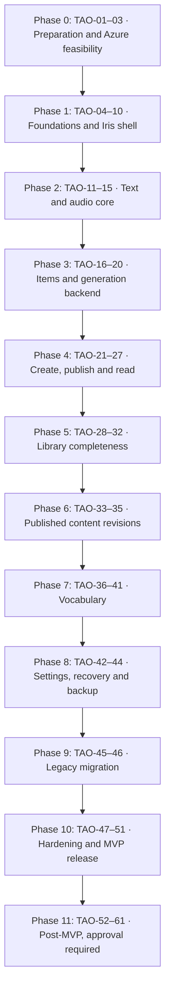

# TaoTale — implementation roadmap

The milestone table records progress. Each completed milestone links to or describes its verification evidence.

The [product overview](01-taotale-overview-and-features.md) defines MVP scope. The [decision register](02-taotale-decision-register.md) owns decision IDs. The [specification index](14-taotale-sources-and-coverage.md) identifies the technical authorities, and the [rebuild plan](13-taotale-rebuild-decisions.md) describes the stages.

**Execution authority:** This is the canonical detailed TaoTale roadmap. All UI work is implemented in the TaoTale client. No external project, component package release or public component API is a prerequisite. The latest owner decision and documents 02, 03 and 08 supersede the former library-first plan.

---

## 1. Scope summary

- **MVP:**
  - a local, single-user app: Go/Gin + PostgreSQL in Docker + local media files, and a SolidJS client with app-owned native controls, CSS Modules and Iris visual design;
  - Library: drafts and published items, Favorites, difficulty, topics, filters;
  - Create/Edit with explicit Azure TTS generation and verified publication; working revisions;
  - Reader with synchronized highlighting;
  - language-scoped Vocabulary and shared Topics;
  - Settings / local data and a tested paired backup and restore;
  - import of the legacy Mandarin Reader data;
  - learning languages `zh-CN` and `ko-KR`; desktop and tablet layouts.
- **Post-MVP (Phase 11):** Dashboard, Vocabulary Practice, AI Text/Audio workspace, Language Islands, phone support, Japanese, optional backlog.
- **Never in the MVP:** login or accounts, billing, cloud hosting, LAN exposure, or routes for deferred features (01 §8).

## 2. Execution and UI ownership rules

1. A milestone can start when its **TaoTale dependencies** are Done. No external release gates or artificial sequencing constraints.
2. Build controls directly in the TaoTale client using native HTML, small SolidJS components, CSS Modules and shared CSS variables. Build reusable controls when a real screen needs them.
3. Use the **Iris Reading Studio** design in 08: violet/lavender, periwinkle and orchid, light/dark paper surfaces, typography, whitespace and restrained CSS effects.
4. No external UI component packages, Kobalte, Tailwind, public slot or theme API, custom focus/keyboard/overlay engine, or formal accessibility certification. Keep native browser behavior and ordinary labels, readable controls and clear states.
5. JavaScript remains for actual product behavior: routing, state, forms, selection, audio, synchronization, persistence and API calls. Keep dialogs native or use simple inline panels; no generic overlay positioning or animation infrastructure.
6. Record milestone status, completed exit criteria and actual evidence in this roadmap or linked implementation notes. No documentation-only pass credit.

## 3. TaoTale execution sequence

The diagram shows a recommended phase order, not extra blocking dependencies. Follow the actual **Depends on** entries in §4 and §7. Start TAO-03 early; after TAO-09, build the Iris shell and a representative Library card (mock fixture) in TAO-10 without waiting for the audio backend. Backend work and client work can proceed independently wherever their real dependencies allow. No new external project is needed.

## 4. Milestone summary

| ID | Milestone | Phase | Depends on | Status |
|---|---|---|---|---|
| TAO-01 | Legacy inventory and migration strategy | 0 | — | Done |
| TAO-02 | Specification reconciliation | 0 | — | Done |
| TAO-03 | Azure Go SDK feasibility spike | 0 | — | Done |
| TAO-04 | Repository and tooling foundation | 1 | TAO-02 | Done |
| TAO-05 | Local Docker PostgreSQL and media root | 1 | TAO-04 | Done |
| TAO-06 | Go/Gin backend skeleton | 1 | TAO-04, TAO-05 | Done |
| TAO-07 | SQL migrations, sqlc and seeds | 1 | TAO-06 | Done |
| TAO-08 | OpenAPI contract pipeline | 1 | TAO-07 | Done |
| TAO-09 | SolidJS client scaffold | 1 | TAO-04, TAO-08 | Done |
| TAO-10 | App shell, routing and Iris theme | 1 | TAO-09 | Done |
| TAO-11 | Unicode offsets and fingerprints | 2 | TAO-01, TAO-06 | Done |
| TAO-12 | Segmentation registry and Mandarin strategies | 2 | TAO-11 | Done |
| TAO-13 | Korean segmentation strategy | 2 | TAO-12 | Done |
| TAO-14 | TTS provider adapter, voice catalog and mock provider | 2 | TAO-03, TAO-08 | Done |
| TAO-15 | MP3 measurement and alignment validation | 2 | TAO-12, TAO-13, TAO-14 | Done |
| TAO-16 | Library item and draft API | 3 | TAO-07, TAO-08 | Done |
| TAO-17 | Topics API | 3 | TAO-07, TAO-08 | Done |
| TAO-18 | Generation admission and idempotency | 3 | TAO-15, TAO-16 | Done |
| TAO-19 | Generation worker, READY pipeline and job recovery | 3 | TAO-18 | Done |
| TAO-20 | Audio streaming, downloads and temporary previews | 3 | TAO-19 | Done |
| TAO-21 | Editor: new item and drafts | 4 | TAO-10, TAO-16 | Done |
| TAO-22 | Library list (basic) | 4 | TAO-10, TAO-16 | Done |
| TAO-23 | Editor: audio generation and preview | 4 | TAO-14, TAO-20, TAO-21 | Done |
| TAO-24 | Publication | 4 | TAO-23 | Planned |
| TAO-25 | Reader page and transcript rendering | 4 | TAO-24 | Planned |
| TAO-26 | Audio player and synchronized highlighting | 4 | TAO-25 | Planned |
| TAO-27 | Reader actions: Favorite, Notes, Download | 4 | TAO-26 | Planned |
| TAO-28 | Topics UI | 5 | TAO-17, TAO-21 | Planned |
| TAO-29 | Library search, filters, sort and Favorites | 5 | TAO-22, TAO-27, TAO-28 | Planned |
| TAO-30 | Cover upload pipeline | 5 | TAO-16 | Planned |
| TAO-31 | Cover UI | 5 | TAO-21, TAO-22, TAO-30 | Planned |
| TAO-32 | Deletion and downloads in the Library | 5 | TAO-20, TAO-22 | Planned |
| TAO-33 | Published metadata edit | 6 | TAO-24, TAO-28, TAO-31 | Planned |
| TAO-34 | Working revisions: backend | 6 | TAO-19, TAO-24 | Planned |
| TAO-35 | Working revisions: client | 6 | TAO-23, TAO-33, TAO-34 | Planned |
| TAO-36 | Vocabulary data model and core API | 7 | TAO-16, TAO-17 | Planned |
| TAO-37 | Vocabulary list, statistics and bulk API | 7 | TAO-36 | Planned |
| TAO-38 | Reader vocabulary collection | 7 | TAO-26, TAO-36 | Planned |
| TAO-39 | Vocabulary view | 7 | TAO-28, TAO-37 | Planned |
| TAO-40 | Reader vocabulary panel | 7 | TAO-38 | Planned |
| TAO-41 | Verified Chinese automatic matching *(conditional)* | 7 | TAO-12, TAO-40 | Planned |
| TAO-42 | Settings and local data | 8 | TAO-10, TAO-14, TAO-26, TAO-40 | Planned |
| TAO-43 | Cleanup, recovery and integrity checks | 8 | TAO-19, TAO-20, TAO-30, TAO-32 | Planned |
| TAO-44 | Paired backup and restore | 8 | TAO-43 | Planned |
| TAO-45 | Legacy import tooling | 9 | TAO-01, TAO-11, TAO-12, TAO-34, TAO-36 | Planned |
| TAO-46 | Legacy verification and rehearsal | 9 | TAO-26, TAO-45 | Planned |
| TAO-47 | Visual polish and supported-device QA | 10 | TAO-21 – TAO-42 | Planned |
| TAO-48 | Performance baselines and budgets | 10 | TAO-46, TAO-47 | Planned |
| TAO-49 | Fault-injection, security and privacy verification | 10 | TAO-44, TAO-46 | Planned |
| TAO-50 | Real Azure bilingual release smoke | 10 | TAO-49 | Planned |
| TAO-51 | MVP acceptance, release report and cutover | 10 | TAO-47 – TAO-50 | Planned |
| TAO-52 | Post-MVP scope approval and ordering | 11 | TAO-51 | Planned |
| TAO-53 | Dashboard | 11 | TAO-52 | Planned |
| TAO-54 | Vocabulary Practice | 11 | TAO-52 | Planned |
| TAO-55 | AI provider re-validation spike | 11 | TAO-52 | Planned |
| TAO-56 | AI text-generation backend | 11 | TAO-55 | Planned |
| TAO-57 | AI workspace UI (`/generate`) | 11 | TAO-56 | Planned |
| TAO-58 | Language Islands Builder | 11 | TAO-52 | Planned |
| TAO-59 | Phone and small-screen support | 11 | TAO-52 | Planned |
| TAO-60 | Japanese (`ja-JP`) support | 11 | TAO-52 | Planned |
| TAO-61 | Optional enhancement backlog | 11 | TAO-52 | Planned |

## 5. Simple app-local UI by screen

| Screen / capability | Native HTML and TaoTale components |
|---|---|
| Client scaffold and shell | CSS variables, CSS Modules, links, native buttons, language select, light/dark/system theme |
| Editor: drafts | Labeled input, textarea, native select, inline validation, native dialog or inline dirty guard |
| Library | Styled cards, badges, CSS skeleton, explicit actions, previous/next buttons, empty/error states |
| Audio generation and preview | Native selects, status text, native audio and range input |
| Reader | Native audio, buttons, range input, select for speed, inline Notes panel or native dialog, exact transcript |
| Topics | Styled chips, checkbox list, inline create/manager, preset swatches |
| Library filters and Favorites | Search input, selects, checkbox filters, visible favorite button |
| Covers | Native file input, thumbnail, remove/retry, inline errors |
| Reader vocabulary | Native text selection, explicit toolbar action, inline panel or native dialog, status badge |
| Vocabulary view | Native table, checkboxes, pagination, search/selects, detail panel, inline feedback |
| Settings | Native selects, radio/checkbox controls, status and manual backup guidance |

Use the app's common Iris palette, spacing, typography, radii and surface rules from 08. Prefer CSS over specialized component JavaScript. Build only what the screen needs.

## 6. Definition of Done (every milestone)

1. **Internal dependencies:** required TaoTale milestones are Done; conditional work is explicitly resolved, including TAO-41 when not enabled.
2. **Simple UI:** app-owned SolidJS and native HTML/CSS only; no external UI component package or custom generic behavior engine. New screens follow the Iris design in 08 and the interaction states in 09.
3. **Contract first:** OpenAPI updated before handlers; generated TypeScript types and sqlc code fresh; SQL migrations forward-only and reviewed.
4. **Tests at the right layer:** Go unit tests, real disposable PostgreSQL integration, Solid component tests and browser end-to-end tests for user-visible flows. Mock TTS in ordinary CI. Paid Azure calls only with explicit owner approval in TAO-03, TAO-50 or a necessary TAO-14 verification.
5. **Visual and functional review:** readable forms, clear action/error states, light/dark Iris colors, no blocked or clipped UI on supported desktop/tablet layouts. Native browser interaction is sufficient; no separate formal accessibility audit.
6. **Privacy and safety:** no private study text, secrets or absolute paths in logs, fixtures or commits; loopback-only defaults intact.
7. **Scope guard:** nothing from Dashboard, Practice, AI workspace, Islands, phone layouts, auth or billing appears in MVP routes, bundles or schema.
8. **Docs updated in the same change** (13 §6): affected specs, 02 entries for decisions and this roadmap's status column.
9. **Evidence, not claims:** record actual results. Skipped or unexecuted tests are never reported as passing (12 §6).

---

## 7. Phases and milestones

### Phase 0 — Preparation and de-risking

*Maps to 01 §9 Stage 0 and 13 §3 Stage 0, with the 13 Stage 2 Azure spike pulled forward.*

> **Operational note:** if the legacy Mandarin Reader data is not already backed up, back it up now. That is a safety action, not roadmap work, and does not wait for implementation milestones.

#### TAO-01 — Legacy inventory and migration strategy

**Goal:** Know exactly what legacy data exists and how it will move into TaoTale without loss.

**Scope**
- A verified, restorable copy of the legacy PostgreSQL database and media, stored outside the project and outside Docker volumes.
- Inventory, using counts and IDs only (no private text in the repository):
  - schema and Prisma migration history, and UUIDs;
  - `native` and other unexpected difficulty values;
  - covers larger than 1,000,000 bytes;
  - pinyin fields;
  - segmentation and fingerprint versions;
  - replay/idempotency rows;
  - manual and automatic vocabulary references;
  - orphan files.
- Freeze legacy golden vectors (v1 Chinese segmentation, legacy fingerprint format) using synthetic or owner-approved texts. Capture a legacy performance baseline for later comparison.
- Choose between importing into a fresh TaoTale schema and upgrading in place. 13 Stage 0 prefers rehearsing on a disposable copy.

**Exit criteria**
- [x] Verified the paired backup on a disposable PostgreSQL 17.11 instance and fresh media directory. All 13 table digests and four media hashes matched.
- [x] Recorded the [inventory, baseline and restore evidence](tao-01-legacy-inventory.md) and the fresh-schema decision TT-033. Listed remaining difficulty and cover choices under OPEN-07.
- [x] Added [eight segmentation and five fingerprint golden vectors](../testdata/legacy/mandarin-v1.json) and checked them against the pinned legacy source.

**Depends on:** —

#### TAO-02 — Specification reconciliation

**Goal:** Bring the specification set in line with current decisions before any code starts.

**Scope**
- Confirm the app-owned UI decision, Iris palette and CSS approach in 02 (TT-028–031; OPEN-10/11 resolved). Remove obsolete external-release obligations from the actual repository.
- Keep the canonical decision IDs in 02. Refer to them by subject throughout the specs and roadmap.
- Verify 03, 08, 09, 12, 13 and 14 point to the current app-owned design and this canonical roadmap; retire the separate duplicate task tracker.

**Exit criteria**
- [x] Confirmed TT-028–031 and recorded roadmap and register ownership in TT-032.
- [x] Consolidated open choices in 02 and checked references against the canonical IDs.
- [x] Verified local Markdown links and anchors, removed old tracker references, and checked the client manifests, lockfile and tracked sources for an external UI dependency or release gate.

**Depends on:** —

#### TAO-03 — Azure Go SDK feasibility spike

**Goal:** Before building the audio backend, prove that Go can produce MP3 audio and reliable word-boundary timing for both `zh-CN` and `ko-KR` (13 Stage 2, OPEN-12).

**Scope**
- A throwaway Go program in `spikes/` on the target OS. Record the SDK's native/CGO dependencies and installation steps.
- Synthesize synthetic Mandarin and Korean passages that cover punctuation, quotes, numbers, line breaks, `&`, `<` and emoji, using candidate voices at rates 0.75, 1 and 1.25.
- Capture the MP3 bytes and every boundary event (offsets, offset units, ticks). Check:
  - SSML escaping and offset mapping;
  - event ordering;
  - cancellation and timeout;
  - two syntheses running concurrently.

  Compare with the legacy Node output where available.
- **Billable:** run only with explicit owner approval, with credentials from the local environment only. Record the number of requests and their cost.

**Exit criteria**
- [x] Private evidence includes six decoded MP3s, raw events, cancellation outcomes and the per-language report. All 126 boundaries passed offline verification. [Spike and results](../spikes/azure-go/README.md)
- [x] TT-034 records a go decision for each tested voice on Linux amd64. The adapter requires CGO and native runtime libraries.

**Depends on:** —

### Phase 1 — Foundations

*Maps to 01 §9 Stage 1 and 13 §3 Stage 1.*

#### TAO-04 — Repository and tooling foundation

**Goal:** TaoTale's repository structure and guardrails.

**Scope**
- Layout per 11 §2: `frontend/`, `backend/`, `infra/`, `docs/`, `spikes/`, and a gitignored `local-data/`.
- Pin the Go, Node and package-manager versions (OPEN-01).
- `.gitignore` for env files, media and dumps; secret scanning; formatting and lint hooks.
- CI skeleton with the stages from 12 §6 as placeholders.
- **Dependency guard:** reject external styled/headless UI packages, Kobalte and Tailwind in TaoTale manifests/imports. Keep runtime dependencies small; justify additions per 03 §1.
- Pin compatible application dependencies and commit lockfiles; no component-package release pipeline.

**Exit criteria**
- [x] The CI workflow verifies frontend format, lint, types, unit tests and build, Go format, modules, vet and tests, and Git secret scanning. Future migration, contract and browser jobs are labeled as placeholders.
- [x] The dependency guard fixture suite proves prohibited manifests, package aliases and imports exit with failure. The native Solid fixture passes.

**Depends on:** TAO-02

#### TAO-05 — Local Docker PostgreSQL and media root

**Goal:** Persistent, loopback-only local infrastructure.

**Scope**
- Decide whether Go runs on the host or in Compose (OPEN-02).
- Compose service:
  - pinned PostgreSQL image, named volume, health check;
  - non-default credentials from a gitignored env file;
  - port bound to `127.0.0.1` only, or not published at all if Go runs in Compose.
- `MEDIA_ROOT` layout (`staging/`, `temporary/audio`, `audio/`, `temporary/images`, `images/`) with restrictive permissions, outside the source tree and container layers.
- Start/stop documentation that marks `docker compose down -v` as forbidden for routine use.

**Exit criteria**
- [x] A disposable Compose run preserved a PostgreSQL row and media bytes after `down` and `up` replaced both containers. The API reported ready before and after, and all media directories used mode `0700` and owner UID 10001.
- [x] Docker reported no PostgreSQL host port bindings on either deployment. The API was published on `127.0.0.1` only.
- [x] TT-036 records the Compose runtime, volume and network choices. The [backend setup](../backend/README.md) documents start and stop commands.

**Depends on:** TAO-04

#### TAO-06 — Go/Gin backend skeleton

**Goal:** A runnable HTTP service that is safe by default.

**Scope**
- Go module and layout per 04 §2. Typed configuration validation: loopback by default, wildcard bind rejected, absolute `MEDIA_ROOT`.
- Gin middleware:
  - request ID, recoverer, 100 KB JSON cap, timeouts;
  - metadata-only structured logs;
  - Host/Origin validation for state-changing requests;
  - strict JSON decoding that rejects unknown fields and invalid UTF-8;
  - the error envelope from 10 §1.
- `pgxpool`, `/health/live`, `/health/ready` (database + media root) and graceful shutdown.
- CI: formatting, vet, static analysis, unit tests and the race detector.

**Exit criteria**
- [x] The Compose smoke test verified loopback publication and both health paths. Database and media failures independently returned `503`, liveness stayed healthy, and readiness recovered after each failure. The API exited cleanly on `SIGTERM`.
- [x] Structured request logs excluded synthetic body, URL and header values. Unit tests also verified panic redaction, Host and Origin checks, strict Unicode JSON decoding, both body-size limit paths and in-flight shutdown.
- [x] CI runs Go format checks, module verification, vet, Staticcheck, unit tests and the race detector.

**Depends on:** TAO-04, TAO-05

#### TAO-07 — SQL migrations, sqlc and seeds

**Goal:** A versioned schema workflow with idempotent seeding.

**Scope**
- Choose the migration runner (OPEN-02). Configure sqlc with `pgx/v5`, and add a CI check that generated code hasn't drifted.
- First migrations: `users`, `learning_languages` (`zh-CN`, `ko-KR`), and `topics` (name key, system key, four colors).
- Seeds: one stable user, the enabled languages, and eight protected default topics. Rerunning the seed keeps IDs and user edits (NFR-15).
- Integration tests on a disposable PostgreSQL. Readiness checks the schema version.
- An early `pg_dump`/`pg_restore` smoke test into a fresh volume (01 §9 Stage 1 exit). The full paired procedure comes in TAO-44.

**Exit criteria**
- [x] Disposable PostgreSQL verified fresh and concurrent startup, rollback on a failed migration, one owner, two enabled languages, eight protected Topics and repeat seeding that preserves edits and IDs. Readiness checks the complete migration history.
- [x] CI checks generated pgx/v5 code with `sqlc diff`. A custom-format `pg_dump` restored into fresh disposable PostgreSQL with matching catalog rows, edited Topic metadata and migration history. [Schema workflow](../backend/README.md)

**Depends on:** TAO-06

#### TAO-08 — OpenAPI contract pipeline

**Goal:** A contract-first API workflow (10 §7).

**Scope**
- The canonical TaoTale OpenAPI 3.1 file with conventions, the error envelope, `X-Request-Id`, health, `GET /languages` and `GET /topics`.
- Choose linting, TypeScript type generation for the client and the Go conformance approach (OPEN-16).
- CI fails on stale generated types or on a mismatch between contract and implementation.
- Rule for all later milestones: extend the contract before writing handlers.

**Exit criteria**
- [x] `GET /languages` and `GET /topics` read PostgreSQL and conform to OpenAPI along with both health aliases. A disposable Compose run verified enabled-language filtering, Topic ordering, nullable system keys and request IDs.
- [x] CI lints OpenAPI, checks generated TypeScript freshness and compares Gin routes and responses to the contract. A deliberately altered declaration failed the freshness check. [API workflow](10-taotale-api.md#7-openapi-and-migration-workflow)

**Depends on:** TAO-07

#### TAO-09 — SolidJS client scaffold

**Goal:** A runnable client with app-owned CSS and native controls (03 §1–3).

**Scope**
- Vite + SolidJS + strict TypeScript + `@solidjs/router`. Verify that lint and formatting handle Solid TSX. Set up component and end-to-end test tooling.
- Configure CSS Modules, one global token/base stylesheet and a simple folder for shared local components. Verify a native button renders with app-owned CSS; no external UI package.
- A typed `fetch` wrapper (`/api/v1`, error envelope, request ID, `AbortController`) using the generated types.
- A typed local-preferences utility with validation and safe fallbacks (`taotale.preferences.*`, 03 §9).
- Serving:
  - in development, a proxy to Gin with an explicit origin allowlist;
  - in production, Gin serves the built SPA from the same origin, with an SPA fallback that never swallows `/api` 404s.

**Exit criteria**
- [x] The existing Vite scaffold builds into the Gin production image. Playwright verified the styled native Favorite button and JSON errors on unknown API routes.
- [x] Desktop and tablet Playwright tests refreshed the Korean sample Reader deep link and preserved the active language.
- [x] The UI dependency guard, frozen installation, TypeScript checks and component tests passed. [Client workflow](../frontend/README.md)

**Depends on:** TAO-04, TAO-08

#### TAO-10 — App shell, routing and Iris theme

**Goal:** The MVP’s navigable, beautifully styled Iris shell (08 §2–4, §6.1–6.2).

**Scope**
- Lazy routes from 03 §5: `/` → `/library`, `/library`, `/create`, `/items/:id`, `/items/:id/edit`, `/vocabulary`, `/settings`, and not-found. No routes or code chunks for deferred features, and no sign-in page.
- Header navigation, and an active-language switcher (native select) fed by `/languages` and saved locally.
- Theme setting (light, dark or system), saved locally and applied before first paint using a small app-local theme initializer where practical.
- Iris theme from 08 §2–4: implement the exact light/dark semantic tokens, base typography, spacing, radii and CSS surface styles.
- Build only a small set of actual controls; add a representative Library card with synthetic content to establish visual direction before real data is available.
- Use native inputs/selects/buttons and CSS hover/pressed/disabled states; no custom overlay, focus or keyboard engine.

**Exit criteria**
- [x] A component test preserved child identity and state through a theme change. Playwright verified that the saved theme applies with the app scripts blocked on refresh.
- [x] Reviewed the Iris shell and synthetic Library card at 1440 × 960 and 768 × 1024 in both themes. Six production browser tests covered navigation, native controls, language persistence and deep links.

**Depends on:** TAO-09

### Phase 2 — Text and audio core

*Maps to 01 §9 Stage 2 and 13 §3 Stage 2.*

#### TAO-11 — Unicode offsets and fingerprints

**Goal:** The exact-text building blocks everything audio-related relies on.

**Scope**
- A Go converter between UTF-8 bytes, Unicode scalars and UTF-16 units (06 §2). It rejects offsets that fall inside a character or a surrogate pair, and rejects invalid UTF-8. Fixtures F3.
- The new canonical fingerprint serializer (schema-versioned, with the fields from 06 §4), with golden vectors for `1` vs `1.0`, non-ASCII text, `<`, `&`, emoji and CRLF.
- A legacy fingerprint verifier that reproduces the Mandarin Reader format, using the frozen vectors from TAO-01.

**Exit criteria**
- [x] Four schema-2 byte and digest vectors and five frozen Mandarin Reader fingerprints pass.
- [x] F3 tests cover all three coordinates, exact boundaries and malformed input. Persisted ranges use half-open UTF-16 coordinates. [Offset and fingerprint conventions](06-taotale-segmentation-and-audio.md)

**Depends on:** TAO-01, TAO-06

#### TAO-12 — Segmentation registry and Mandarin strategies

**Goal:** Versioned Chinese segmentation that keeps old recordings valid.

**Scope**
- A registry keyed by language code + strategy ID/version. No fallback to Chinese rules, and no Japanese placeholder.
- `zh-cn-legacy-v1`, reproducing the historical behavior exactly (06 §3.1), for existing recordings.
- `zh-cn-phrase` v1 for new generations. Freeze its punctuation, quote and paragraph rules through owner-approved golden vectors (OPEN-03).
- Fixtures F1-CN and F2, including exact reconstruction of the gaps between segments.

**Exit criteria**
- [x] The owner approved the v1 rules recorded in 02. Mandarin vectors and the frozen legacy fixture reconstruct the source exactly.

**Depends on:** TAO-11

#### TAO-13 — Korean segmentation strategy

**Goal:** An independent Korean strategy — not a fork of the Chinese one (06 §3.2).

**Scope**
- `ko-kr-phrase` v1, which handles:
  - sentence punctuation (ASCII and full-width), closing quotes and brackets, paragraphs;
  - decimals, abbreviations, ellipses and parentheticals;
  - mixed Latin text and digits;
  - long lines without punctuation, under a bounded policy.

  No morphology.
- Fixtures F1-KO; owner-approved golden vectors.

**Exit criteria**
- [x] The owner approved the Korean v1 rules. A shared mixed-script vector verifies that Korean keeps commas and semicolons within a sentence while Mandarin splits on them.

**Depends on:** TAO-12

#### TAO-14 — TTS provider adapter, voice catalog and mock provider

**Goal:** Azure kept behind a provider-neutral interface (TT-010).

**Scope**
- A domain `TTSProvider` interface: list voices, and synthesize → MP3 + boundary events + typed errors.
- The Azure adapter, productionized from TAO-03: backend-only credentials, region, timeout, cancellation and error mapping.
- A per-language voice allowlist with verified `zh-CN`/`ko-KR` voices and the rates each voice supports (OPEN-08), served by `GET /tts/voices?languageCode=`.
- A deterministic mock provider, visibly labelled "(mock)", used by every automated test. No paid calls in CI.
- With credentials missing, generation reports `TTS_UNAVAILABLE` and reading is unaffected.

**Exit criteria**
- [x] The OpenAPI catalog conforms to the Gin route, and offline tests cover deterministic mock output, unavailable credentials, native error mapping and worker timeouts.

**Depends on:** TAO-03, TAO-08

#### TAO-15 — MP3 measurement and alignment validation

**Goal:** Audio is marked READY only on verified evidence (06 §5–§6).

**Scope**
- Choose and verify an MP3 decoder/probe that measures duration (OPEN-13).
- SSML generation with escaping and an index map back to the source text.
- Boundary normalization: validate the raw events, coalesce events per segment, and apply floor/ceil only after validation.
- The READY validation gate with a typed `ALIGNMENT_UNRELIABLE` error. The legacy 50 ms clamp applies only when validating legacy assets.
- Fixtures F4 and F5; replay the real outputs recorded in TAO-03.
- Decide whether to keep 1,500 UTF-16 units or plan chunking (OPEN-04).

**Exit criteria**
- [x] All six TAO-03 Mandarin and Korean recordings validated offline. Invalid audio, missing coverage, and timing or identity mismatches return `ALIGNMENT_UNRELIABLE`.
- [x] Documented exact timing and the legacy-only 50 ms final-end clamp.

**Depends on:** TAO-12, TAO-13, TAO-14

### Phase 3 — Items and generation backend

*Maps to 01 §9 Stage 2 and 13 §3 Stage 3.*

#### TAO-16 — Library item and draft API

**Goal:** Persist language-scoped items and drafts.

**Scope**
- Migration for `library_items` and `item_topics`, plus sqlc queries.
- Endpoints:
  - `POST /items`: a draft; language required and immutable;
  - `GET /items/{id}`;
  - versioned `PATCH`, which tells omitted, `null`, empty and `false` apart;
  - `DELETE`;
  - a basic `GET /items`: language required, newest first with stable ties, 8 per page, bounded page size.
- Validation:
  - limits from 01 §7, counting Unicode code points or UTF-16 units as specified;
  - difficulty is one of the three levels or `null` — `native` is rejected;
  - at most 10 owned topics;
  - the owner is resolved by the server, and unknown or foreign IDs return the same not-found.

**Exit criteria**
- [x] PostgreSQL integration tests verify `409 VERSION_CONFLICT`, atomic rollback on an unknown Topic, and stable language-scoped pages.
- [x] Gin routes and their responses conform to OpenAPI.

**Depends on:** TAO-07, TAO-08

#### TAO-17 — Topics API

**Goal:** One user-global topic catalog shared by both languages.

**Scope**
- `GET/POST /topics` and `PATCH/DELETE /topics/{id}`, with these rules:
  - names are unique case-insensitively and 1–40 code points long;
  - preset colors are resolved by the server (08 §2.3); retain stored color validation from 05;
  - default topics are protected; deletion removes joins only;
  - duplicate errors include the existing ID; usage counts are returned.
- Settle `/topics` naming and whether any `/tags` alias is needed (OPEN-14).

**Exit criteria**
- [x] Tests verify Unicode case-folded uniqueness, shared usage counts, association cleanup, and preservation of renamed and recolored defaults on seed rerun.

**Depends on:** TAO-07, TAO-08

#### TAO-18 — Generation admission and idempotency

**Goal:** Paid TTS requests are durable, never duplicated, and capped.

**Scope**
- Migrations for `audio_generations`, `audio_assets` (segments stored as JSONB) and `idempotency_records`.
- Endpoints:
  - `POST /items/{id}/audio/generate`: targets a saved draft, requires an `Idempotency-Key`, snapshots the saved inputs immutably (including strategy ID/version), returns `202`;
  - `GET …/generations/{id}`.
- Admission transaction:
  - writes PENDING and reserves the key; allows one active job per target;
  - same key + same intent replays the original;
  - same key + different intent → `409 IDEMPOTENCY_KEY_REUSED`;
  - tombstones remain after replay records expire.
- Cost caps: concurrency (initially 2) and an hourly limit (initially 60) return `429 TTS_RATE_LIMITED` before any provider call.
- Computed `NOT_GENERATED` and `OUTDATED` states.

**Exit criteria**
- [x] Sixteen concurrent duplicate requests resolve to one job. PostgreSQL tests cover competing targets, both admission caps, immutable snapshots, expired receipts and deletion.
- [x] OpenAPI contract tests cover admission, replay, rejection and polling, including outdated and unavailable assets.

**Depends on:** TAO-15, TAO-16

#### TAO-19 — Generation worker, READY pipeline and job recovery

**Goal:** Turn admitted jobs into verified, immutable audio — or typed failures.

**Scope**
- In-process worker:
  1. atomically claim a job → PROCESSING with a heartbeat;
  2. call the provider outside any SQL transaction;
  3. staging file → MP3 check and measured duration → alignment validation → immutable promotion;
  4. one transaction creates the asset and sets READY (DB-1, DB-2).
- Typed FAILED codes; staging cleanup; no automatic resubmission.
- Startup reconciliation: interrupted jobs become FAILED with `GENERATION_INTERRUPTED` and are never resubmitted. Readiness waits until reconciliation finishes.

**Exit criteria**
- [x] Replaying an admitted key yields one synthesis call in the counting mock.
- [x] Killing a worker inside synthesis leaves a recorded heartbeat. Startup marks its active and queued jobs interrupted and replay preserves their outcomes.
- [x] A destination collision preserves published bytes. A forced READY transaction failure rolls back asset metadata and startup removes the orphan file.

**Depends on:** TAO-18

#### TAO-20 — Audio streaming, downloads and temporary previews

**Goal:** Safe playback and preview flows.

**Scope**
- Asset-pinned audio routes with single-range `206`/`416` responses, `audio/mpeg` and private caching. Downloads use safe, server-generated filenames.
- Temporary previews: `POST /tts/previews`, plus status, audio and download routes. Previews expire after 24 hours, are claimed on Save Draft (DB-3), and return a typed `PREVIEW_NOT_FOUND` once gone.

**Exit criteria**
- [x] Range and pinning tests pass: a stale URL never serves new bytes.
- [x] Claim and expiry tests pass.

**Depends on:** TAO-19

### Phase 4 — Create, publish and read

*Maps to 01 §9 Stage 2 and 13 §3 Stage 3.*

#### TAO-21 — Editor: new item and drafts

**Goal:** Explicit, safe draft editing (09 §5).

**Scope**
- `/create` and `/create?draftId=`. One store-based editor with a confirmed baseline, and memoized checks for "dirty" and "synthesis inputs changed" (03 §7).
- Fields:
  - language (new items only);
  - title;
  - exact source: a Textarea of at least 6 rows, with counters in the right counting unit;
  - description and notes;
  - difficulty: Beginner, Intermediate, Advanced or Unspecified.
- Saving:
  - explicit Save Draft, which replaces the URL with the `draftId`;
  - inline validation with visible field errors;
  - inputs kept on failure; a review step on version conflicts.
- Dirty guard: in-app navigation goes through `useBeforeLeave` and a simple native dialog or inline confirmation (Save Draft & Leave / Leave Without Saving / Stay). Closing or reloading the tab uses the browser's native `beforeunload` (09 §9).
- Layout per 08 §6.3, for desktop and tablet.

**Exit criteria**
- [x] End-to-end test: create → save → reload → continue.
- [x] Every dirty-guard choice tested; no autosave.

**Depends on:** TAO-10, TAO-16

#### TAO-22 — Library list (basic)

**Goal:** The main entry point lists saved items.

**Scope**
- `/library`: a language-scoped grid (max ~1480 px, 24 px gaps, responsive columns for desktop and tablet).
- LibraryItemCard (a TaoTale component):
  - placeholder cover; title, or "Untitled draft";
  - description, difficulty, draft/published badge, dates;
  - a visible Continue Editing or Open in Reader action.
- Page number kept in the URL and clamped to the valid range.
- States: skeleton, true empty (offering Create New Item), error with Retry, and stale data while refreshing (09 §2).

**Exit criteria**
- [x] End-to-end test with seeded data.
- [x] One list request per page — no per-card requests.
- [x] Cards follow the Iris visual spec (08 §6.2); actions are visible and usable.

**Depends on:** TAO-10, TAO-16

#### TAO-23 — Editor: audio generation and preview

**Goal:** Explicit, cost-safe audio generation from the editor.

**Scope**
- Voice and rate pickers filtered by the item's language, defaulting to the per-language preferences saved locally.
- Generate Audio:
  - uses one idempotency key per intent;
  - after an unknown outcome, recovers with the same key and body;
  - never retries automatically;
  - unsaved synthesis inputs block generation until saved.
- Status shown with text labels (Not generated, Pending, Processing, Ready, Failed, Outdated). Bounded polling stops at a final state or when the page closes.
- Preview player (TaoTale's AudioPlayer, basic: play/pause, timeline, duration) on the asset-pinned candidate; candidate download; a temporary-preview path for unsaved items.
- Provider-unavailable and rate-limit states. A persistent explanation of why Publish is disabled.

**Exit criteria**
- [x] End-to-end test with the mock: generate → Ready → preview.
- [x] A backend restart mid-job shows the interruption without a duplicate provider call.
- [x] Editing the source marks the audio Outdated.

**Depends on:** TAO-14, TAO-20, TAO-21

#### TAO-24 — Publication

**Goal:** Publish only verified, matching audio.

**Scope**
- Backend:
  - `POST /items/{id}/publish`: takes the expected version and re-checks the matching READY asset inside the transaction (DB-4);
  - direct `POST /items/publish`: claims a preview and requires an idempotency key.
- Client: Publish to Library, with a persistent explanation when disabled. On success, navigate to `/items/{id}` and replace the editor entry in history. On failure, the draft and its audio stay intact.

**Exit criteria**
- [ ] A mismatched or stale candidate can't be published (NFR-05).
- [ ] End-to-end test: create → generate → publish lands on the Reader route.

**Depends on:** TAO-23

#### TAO-25 — Reader page and transcript rendering

**Goal:** Exact, readable text, even when the audio isn't usable.

**Scope**
- Route states: a published item opens the Reader; a draft offers Continue Editing; an unknown ID shows not-found.
- Layout: an Iris ~960 px shell, a ~720–780 px transcript, a fixed player area with bottom space, and no global header on the exact Reader route.
- Exact-source rendering from the source plus stored segments, validated against the JS string, with `pre-wrap` and blank lines kept. The client never re-segments the text.
- Language-appropriate local fonts: a Noto Serif SC subset for `zh-CN`; a separately tested Korean font stack.
- Fallback: if the alignment is corrupt or the media is missing, show readable text, disable seeking, and show an error with Retry.

**Exit criteria**
- [ ] `zh-CN` and `ko-KR` fixtures render byte-exact text.
- [ ] Fallback covered by an end-to-end test.

**Depends on:** TAO-24

#### TAO-26 — Audio player and synchronized highlighting

**Goal:** Playback that stays in sync with the text without slowing the UI down (03 §8, 06 §7).

**Scope**
- AudioPlayer on a native `HTMLAudioElement`: play/pause, ±5 s, speeds 0.75/1/1.25/1.5, timeline, elapsed/total, download.
- Sync engine:
  - a precomputed timing index searched with binary search;
  - the active-segment signal changes only when the segment changes;
  - a `requestAnimationFrame` loop runs only while playing;
  - the progress readout is isolated from the rest of the UI.
- Clicking a timed segment seeks to it and keeps the play state. Selecting or dragging text never triggers a seek. Ending playback clears the highlight; the next Play starts from 0.
- Resume position saved per `(itemId, audioAssetId)` every ~5 s and on pause. No autoplay when restoring.

**Exit criteria**
- [ ] NFR-03 met at every speed, for both `zh-CN` and `ko-KR`.
- [ ] An instrumented test proves the transcript doesn't re-render on each tick (NFR-04).
- [ ] Listeners and animation frames are cleaned up on navigation.

**Depends on:** TAO-25

#### TAO-27 — Reader actions: Favorite, Notes and Download

**Goal:** Metadata actions in the Reader that never interrupt playback.

**Scope**
- Backend `PUT /items/{id}/favorite` sets the value:
  - idempotent;
  - no change to `updatedAt` or the version;
  - never overwritten by later content updates (DB-6).
- Reader header:
  - Favorite / Remove from Favorites, with pending, confirmed and failure states;
  - a Notes panel or native dialog with explicit edit/save/cancel and dirty protection;
  - Download Audio and Back to Library.
- Favorite, Notes, theme and dialog changes never remount the player or the transcript.

**Exit criteria**
- [ ] The favorite survives a restart without a version change.
- [ ] Audio keeps playing through Notes and theme changes (tested).

**Depends on:** TAO-26

### Phase 5 — Library completeness

*Maps to 01 §9 Stage 3 and 13 §3 Stage 3.*

#### TAO-28 — Topics UI

**Goal:** Manage topics and assign them to items.

**Scope**
- Local CSS topic chips that use the stored light/dark colors.
- A simple checkbox list or native multiselect in the editor, with inline create, max 10.
- TopicManager inline panel or native dialog:
  - create, rename, and recolor via named swatches (native radio inputs);
  - delete custom topics, showing how many items and words use them;
  - default topics are protected;
  - a duplicate-name conflict keeps what the user typed.

**Exit criteria**
- [ ] End-to-end topic lifecycle passes.
- [ ] The same topic works on `zh-CN` and `ko-KR` items.

**Depends on:** TAO-17, TAO-21

#### TAO-29 — Library search, filters, sort and Favorites

**Goal:** The full Library browsing experience (01 §4.1).

**Scope**
- Backend `GET /items`:
  - filters: literal escaped title search (≤120 code points), status, difficulty including Unspecified, topics (OR), `favoritesOnly`;
  - sorts: newest, oldest, title A–Z and Z–A, with ID tie-breaks;
  - joins are batched, and indexes are justified by `EXPLAIN (ANALYZE, BUFFERS)`.
- Client URL state (03 §5):
  - parameters canonicalized;
  - search debounced 300 ms with history replace;
  - deliberate filter changes push a history entry;
  - the page resets or clamps.
- Filter bar: search, sort, difficulty, status, Favorites only and topics. An empty-filter state offers Clear filters.
- Card favorite star:
  - a visible native star button that sets the value and shows pending/failure;
  - it never opens the item;
  - unfavoriting under Favorites-only removes the card and keeps a sensible page.

**Exit criteria**
- [ ] Acceptance journey 5 (01 §10) automated.
- [ ] Favoriting never changes the newest-first order.

**Depends on:** TAO-22, TAO-27, TAO-28

#### TAO-30 — Cover upload pipeline

**Goal:** Safe, bounded cover images (TT-016).

**Scope**
- `POST /storage/images`:
  - bounded streaming, max 1,000,000 encoded bytes inclusive;
  - checks the real JPEG/PNG/WebP signature and the decoded dimensions (≤4096×4096);
  - protection against decompression bombs;
  - staging then promotion, with safe server-generated keys.
- `GET /storage/images/{id}` with ETag/304.
- A cover is attached or replaced through item updates, only after a successful save. Legacy oversized covers stay readable.

**Exit criteria**
- [ ] F6 fixtures pass, including 1,000,000 bytes accepted and 1,000,001 rejected.
- [ ] Path-traversal attempts are rejected.

**Depends on:** TAO-16

#### TAO-31 — Cover UI

**Goal:** Cover selection in the editor and covers on Library cards.

**Scope**
- A native file input with an Iris-styled cover preview:
  - client-side size, type and dimension checks that mirror the server's;
  - a thumbnail and remove/retry actions;
  - errors keep the old cover.
- Library cards load covers lazily and fall back to a placeholder when a cover fails.

**Exit criteria**
- [ ] Acceptance journey 7 automated.
- [ ] A failed replacement never removes the existing cover.

**Depends on:** TAO-21, TAO-22, TAO-30

#### TAO-32 — Deletion and downloads in the Library

**Goal:** Destructive and download actions done safely (09 §4).

**Scope**
- Delete:
  - a native confirmation or simple dialog stating the consequences: the recording is removed, vocabulary entries survive;
  - a transactional delete;
  - after commit, release the item's own media without touching shared or still-referenced files.
- Download Audio for published items, with error states for missing media; correct pagination after a delete.

**Exit criteria**
- [ ] Delete covered by an end-to-end test.
- [ ] Media release never deletes referenced files (tested).

**Depends on:** TAO-20, TAO-22

### Phase 6 — Editing published content

*Maps to 01 §9 Stage 2–3 and 13 §3 Stage 3.*

#### TAO-33 — Published metadata edit

**Goal:** Change metadata without touching the recording (TT-023).

**Scope**
- `/items/{id}/edit` in metadata mode: title, description, notes, difficulty, topics, cover. The synthesis inputs are locked, with an "Edit Text & Voice" button that leads into a working revision.
- Versioned PATCH. Metadata changes never touch the active asset or its fingerprint. Review step on conflicts.

**Exit criteria**
- [ ] The metadata part of acceptance journey 4 is automated; the audio is unchanged after metadata edits.

**Depends on:** TAO-24, TAO-28, TAO-31

#### TAO-34 — Working revisions: backend

**Goal:** Edit text, voice or rate of published content without risking the published version.

**Scope**
- `working_revisions` migration. Endpoints: `POST /items/{id}/revisions` (200 existing / 201 new) and versioned GET/PATCH/DELETE.
- Revision generation. Candidate stream and download never fall back to the published bytes (D-12). A new revision starts as NOT_GENERATED (D-13).
- Revision publish (DB-5):
  - lock the item and the revision;
  - check the versions and the base asset;
  - swap source, voice, rate and asset atomically, keeping the metadata and favorite.

**Exit criteria**
- [ ] A failed or abandoned candidate leaves the published pair playable.
- [ ] A stale revision → 409.

**Depends on:** TAO-19, TAO-24

#### TAO-35 — Working revisions: client

**Goal:** The revision workflow in the editor (09 §5).

**Scope**
- Editor revision mode: Save Revision, Generate, Publish Revision, and Discard Revision (with confirmation). The dirty guard offers "Save Revision & Leave".
- The Reader keeps playing the published recording the whole time. Publishing a revision clears the old resume position.

**Exit criteria**
- [ ] Acceptance journey 4 automated end to end.

**Depends on:** TAO-23, TAO-33, TAO-34

### Phase 7 — Vocabulary

*Maps to 01 §9 Stage 2–3 and 13 §3 Stage 4.*

#### TAO-36 — Vocabulary data model and core API

**Goal:** Language-scoped vocabulary that can't mix languages (TT-007, TT-017).

**Scope**
- Migrations:
  - `vocabulary_entries`: unique per user + language + normalized key;
  - `vocabulary_references`: composite keys enforce the same owner and the same language, and `manual_linked OR auto_linked` must hold;
  - `vocabulary_topics`.
- Normalization — trim, NFC, collapse internal whitespace, case-sensitive — documented and tested. The original spelling is kept.
- Create, get, patch, delete; lookup; link/unlink references; the Reader projection `GET /items/{id}/vocabulary`; race-safe duplicate creation.
- Deleting an item removes its references but never the entries (re-test TAO-32).

**Exit criteria**
- [ ] F8 isolation tests pass: the same spelling in two languages is allowed, and a cross-language link is rejected.

**Depends on:** TAO-16, TAO-17

#### TAO-37 — Vocabulary list, statistics and bulk API

**Goal:** Server-side browsing and bulk management.

**Scope**
- `GET /vocabulary`:
  - language required;
  - search across spelling, reading and meaning;
  - status and topic filters, stable sorts, 10 per page.
- `GET /vocabulary/stats`.
- `POST /vocabulary/bulk`: atomic status change or delete, limited to owned, same-language IDs.
- Limits for reading/reading-system, meaning and note. Review the spelling limit for Korean phrases.

**Exit criteria**
- [ ] F7-scale query plans with no N+1 queries.
- [ ] Bulk atomicity tests pass.

**Depends on:** TAO-36

#### TAO-38 — Reader vocabulary collection

**Goal:** Collect words from the Reader explicitly (09 §6).

**Scope**
- Selection measured from DOM ranges in UTF-16, across timed segments and gaps. Selection rules are per language: the legacy Mandarin restrictions aren't applied to Korean without tests (D-07).
- Add to Vocabulary via a visible Reader toolbar action for the current native text selection; no anchored popover engine or custom segment keyboard behavior.
- Lookup → link an existing word ("Already in Vocabulary", without overwriting its metadata), or open a simple inline form or native Add dialog. Cancel creates nothing; the word and its reference are created atomically.

**Exit criteria**
- [ ] The collection part of acceptance journey 8 passes for both `zh-CN` and `ko-KR`.

**Depends on:** TAO-26, TAO-36

#### TAO-39 — Vocabulary view

**Goal:** The `/vocabulary` management screen (08 §6.5).

**Scope**
- Summary stats; a server-paginated native HTML table styled with CSS Modules; search, status and topic filters; sorting; filters kept in the URL.
- Detail region:
  - edit word, reading, reading system, meaning, note and topics;
  - manual status;
  - references with drill-down to items;
  - delete.
- Bulk selection (a checkbox column with select-all) for status changes and deletion. Inline status text summarizes the result, in addition to the updated table.

**Exit criteria**
- [ ] End-to-end tests, including bulk operations, and a failed update that keeps the last confirmed status.

**Depends on:** TAO-28, TAO-37

#### TAO-40 — Reader vocabulary panel

**Goal:** See and manage the words linked to the open item.

**Scope**
- A Reader toolbar panel listing this item's linked words (manual references) with reading, meaning, topics, and manual Learning/Acquired toggles that show pending and failure states.
- Display settings (Both / Learning / Acquired), saved in `taotale.preferences.reader`.

**Exit criteria**
- [ ] Status changes refresh the panel and the Vocabulary view without remounting the audio.

**Depends on:** TAO-38

#### TAO-41 — Verified Chinese automatic matching (conditional)

**Goal:** Turn on automatic highlighting only where tests prove it is trustworthy (OPEN-05).

**Scope**
- Exact-match annotation for `zh-CN` (longest match, then earliest, then stable ID), behind a per-language capability flag.
- If enabled:
  - in-text underlines — Learning dotted, Acquired solid — with a legend;
  - word details in a simple panel outside the transcript DOM;
  - publication-time reconciliation that keeps manual and automatic provenance separate;
  - `POST /items/{id}/vocabulary/sync`.
- For Korean (and for Chinese if not enabled): a typed "unsupported" response. No fake highlights or counts.

**Exit criteria**
- [ ] Decision recorded in 02.
- [ ] If enabled: annotation never disturbs selection, seeking or audio.
- [ ] This milestone may close as "Not enabled" without blocking the MVP.

**Depends on:** TAO-12, TAO-40

### Phase 8 — Settings, resilience and backup

*Maps to 01 §9 Stages 3–4 and 13 §3 Stage 4.*

#### TAO-42 — Settings and local data

**Goal:** Local preferences and honest local-data information (01 §4.6, 09 §8).

**Scope**
- Preferences: theme, active language, per-language default voice and rate, default Reader speed and vocabulary popup visibility. All client-local, validated, with safe fallbacks.
- A system status endpoint with no secrets: Azure configured/available, database/schema status, media root health, app and segmentation versions.
- Local Data section: honest manual backup/restore guidance with copyable commands (inline text confirms the copy). No inert Backup button.
- Decide:
  - how much of the media path to show — 01 §4.6 asks to show it, while 10 and 11 forbid leaking absolute paths in errors and logs;
  - whether an in-app data reset exists. If yes, it needs confirmation and a prompt to back up first.

**Exit criteria**
- [ ] Corrupt or blocked browser storage falls back safely (tested).
- [ ] Decisions recorded.

**Depends on:** TAO-10, TAO-14, TAO-26, TAO-40

#### TAO-43 — Cleanup, recovery and integrity checks

**Goal:** The local data stays consistent over time (DB-9, 11 §5).

**Scope**
- Bounded cleanup (~every 60 min) of:
  - expired previews and unattached uploads;
  - superseded candidates (D-35);
  - orphan files.

  It uses fresh database checks and file leases, and never deletes active assets, revision bases or the latest candidates.
- A read-only integrity check comparing database references with files, checksums and durations.
- Disk-full, permission and missing-file handling with typed errors.

**Exit criteria**
- [ ] Fault fixtures for missing media and a full disk pass.
- [ ] Cleanup never deletes live media.

**Depends on:** TAO-19, TAO-20, TAO-30, TAO-32

#### TAO-44 — Paired backup and restore

**Goal:** Backups that are proven to restore (TT-005, 11 §7).

**Scope**
- Backup procedure/scripts:
  1. quiesce writes and the worker;
  2. a custom-format `pg_dump`;
  3. an archive of the media;
  4. a manifest: timestamp, schema revision, app and segmentation versions, checksums.

  Store backups outside Docker volumes and the source tree.
- Rehearse restore into a fresh volume and an empty media root, then compare integrity. Verify commands for the target OS (OPEN-06).

**Exit criteria**
- [ ] NFR-08: the restored instance has zero missing active assets, and identical fingerprints, timings, favorites, topics and vocabulary.

**Depends on:** TAO-43

### Phase 9 — Legacy migration

*Maps to 13 §3 Stage 5. 01 §9 puts data migration in Stage 1. Here the import waits until the full schema exists; Stage 1's protection (backup and inventory) is done early in TAO-01.*

#### TAO-45 — Legacy import tooling

**Goal:** Bring Mandarin Reader data into TaoTale without loss (TT-022).

**Scope**
- An importer that reads a **copy** of the legacy database and media, and preserves:
  - UUIDs, timestamps and exact source bytes;
  - topics (tags → topics) and their colors;
  - statuses, and references (the legacy source pointer becomes a manual reference);
  - audio bytes, with their legacy fingerprint and `zh-cn-legacy-v1` identity.
- Backfill: `zh-CN`, `is_favorite=false`, pinyin → `reading` with `reading_system='pinyin'`, and the Learning/Acquired status.
- Report `native` or other unexpected difficulty values and covers over 1,000,000 bytes. Apply only owner-approved mappings (OPEN-07) and preserve covers.
- Idempotent: running it twice gives the same result.

**Exit criteria**
- [ ] Dry-run report approved.
- [ ] The import runs twice on disposable copies with the same result.

**Depends on:** TAO-01, TAO-11, TAO-12, TAO-34, TAO-36

#### TAO-46 — Legacy verification and rehearsal

**Goal:** Evidence that the imported data behaves exactly as before.

**Scope**
- Compare counts, checksums, active assets, references and Reader offsets. Legacy published items must play with unchanged highlighting, and legacy covers must stay readable.
- Optional compatibility (03 §5, §9):
  - a one-time migration of legacy `mr.*` browser keys, if served from the same origin;
  - a redirect for legacy `/library?tab=vocabulary` URLs.

**Exit criteria**
- [ ] Rehearsal report shows zero loss.
- [ ] Rollback path documented.

**Depends on:** TAO-26, TAO-45

### Phase 10 — Hardening and MVP release

*Maps to 01 §9 Stage 4 and 13 §3 Stages 4–5.*

#### TAO-47 — Visual polish and supported-device QA

**Goal:** Meet NFR-11 and NFR-12 on every supported device.

**Scope**
- Review Library, Editor, Reader, Vocabulary and Settings against 08: Iris palette, typography, spacing, cards, visual hierarchy, consistent controls, loading/empty/error states, coordinated light/dark themes.
- Review desktop at 1280/1440 px and a representative tablet (768–1024 px). Check overflow, hidden actions, clipped text and player overlap. Use Chromium first and record the supported browser/viewport baseline (OPEN-15). Phone QA is deferred.
- Check ordinary native interactions, text selection and stable playback during theme and panel changes. No formal accessibility certification or component behavior audit.

**Exit criteria**
- [ ] NFR-11 and NFR-12 met.
- [ ] Screenshot review and functional checks pass; no blocking visual or interaction defects.

**Depends on:** TAO-21 to TAO-42

#### TAO-48 — Performance baselines and budgets

**Goal:** Measured performance with enforced budgets (03 §10, 12 §6).

**Scope**
- An F7 dataset generator: 1,000 published items and 100 drafts, 10,000 words and 100 topics across both languages.
- Measure NFR-01 to NFR-04 on the reference machine:
  - API p95 and first useful render;
  - Reader sync accuracy and input delay;
  - memory stability;
  - app JS/CSS size.
- Set numeric budgets and add CI regression checks.

**Exit criteria**
- [ ] Baseline report published.
- [ ] Budgets recorded, and regressions fail CI.

**Depends on:** TAO-46, TAO-47

#### TAO-49 — Fault-injection, security and privacy verification

**Goal:** Evidence for the resilience and local-security claims (11 §6, §8).

**Scope**
- Faults:
  - restart mid-generation and abrupt termination;
  - full disk and permission errors;
  - missing or corrupt media and alignment;
  - database outage and migration checksum mismatch;
  - expired previews and duplicate keys.
- Security:
  - Host/Origin checks, DNS rebinding and cross-site writes;
  - path traversal, symlink escape and hostile uploads;
  - log redaction and no secrets in bundles or logs;
  - dependency, licence and secret scans for application dependencies.

**Exit criteria**
- [ ] Evidence recorded for NFR-06, NFR-09 and NFR-13.

**Depends on:** TAO-44, TAO-46

#### TAO-50 — Real Azure bilingual release smoke

**Goal:** Prove the real provider works end to end in both languages (06 §9).

**Scope**
- An explicit, billable, owner-approved run on the target OS for both `zh-CN` and `ko-KR`: create → generate → READY → publish → synchronized Reader → vocabulary → restart and reopen.
- A human listening check.

**Exit criteria**
- [ ] Evidence recorded.
- [ ] Any language that can't produce reliable timing blocks the release (12 §3).

**Depends on:** TAO-49

#### TAO-51 — MVP acceptance, release report and cutover

**Goal:** Accept, document and switch over to the MVP.

**Scope**
- Run the 12 journeys from 01 §10 and 12 §5, the NFR gates, and the scope gate (no deferred routes, login or billing).
- Release report (12 §6): commit, migration revision, OpenAPI hash, Solid/client versions, real test counts, coverage, audits, performance, restore checksums, known limitations.
- Cut over from the legacy app using the verified import, keeping backups for rollback.

**Exit criteria**
- [ ] Owner acceptance recorded in 02.

**Depends on:** TAO-47 to TAO-50

### Phase 11 — Post-MVP

*Maps to 01 §8, 07 and 13 §5.*

Each item needs a scope decision in 01 and 02 first (TAO-52). Each is broken into small milestones with full Goal/Scope/Exit sections when it is scheduled. None of them may be prebuilt during the MVP.

| ID | Milestone | Depends on | Notes |
|---|---|---|---|
| TAO-52 | Post-MVP scope approval and ordering | TAO-51 | Closes OPEN-09, picks the order and updates 01 and 02. |
| TAO-53 | Dashboard | TAO-52 | 01 §8.1: active language, Continue Reading, recent items, Favorites, per-language counts. |
| TAO-54 | Vocabulary Practice | TAO-52 | 01 §8.2: manual recall and reveal, explicit status changes; no SRS or scoring. |
| TAO-55 | AI provider re-validation spike | TAO-52 | 07 §6: re-check the provider, authorization and credential storage on the target OS. Billable only with approval. |
| TAO-56 | AI text-generation backend | TAO-55 | 07 §4–§6: an isolated adapter, idempotent claims, output validation, no automatic writes. |
| TAO-57 | AI workspace UI (`/generate`) | TAO-56 | 07 §3, §8: lazy route, reviewable candidates, data-sharing disclosure, hand-off to the existing draft/TTS/publish flow. |
| TAO-58 | Language Islands Builder | TAO-52 | 01 §8.4: reuse items, jobs and the Reader; hide/reveal prompts for rehearsal. |
| TAO-59 | Phone and small-screen support | TAO-52 | Phone layouts and navigation, touch-friendly transcript interactions, testing on real devices. |
| TAO-60 | Japanese (`ja-JP`) support | TAO-52 | Its own segmentation strategy, voices and fonts; Chinese rules are never reused. |
| TAO-61 | Optional enhancement backlog | TAO-52 | FEAT-01 to FEAT-07 (13 §5), one-click and encrypted backup, local usage tracking, LAN access (needs its own security decision). |

---

## 8. Open decisions and where they close

| Open item | Source | Closed in |
|---|---|---|
| Exact versions and build tooling | OPEN-01 | TAO-04 (toolchain), TAO-07 (DB stack), TAO-09 (client) |
| Compose runtime and database port isolation, SQL migration runner and seed strategy | OPEN-02 | TAO-05 (runtime and isolation), TAO-07 (migration and seed) |
| Segmentation rules and offset convention | OPEN-03 | TAO-11, TAO-12, TAO-13 |
| Source length vs chunking | OPEN-04 | TAO-15 |
| Automatic vocabulary matching | OPEN-05 | TAO-41 |
| Backup workflow and packaging | OPEN-06 | TAO-44 |
| Legacy difficulty values and oversized covers | OPEN-07 | TAO-01 (report), TAO-45 (decision) |
| TTS limits, voices, provider configuration | OPEN-08 | TAO-14, TAO-18 |
| Post-MVP order | OPEN-09 | TAO-52 |
| App-local UI ownership (resolved) | OPEN-10, TT-028–029 | TAO-02 confirms repository docs |
| Iris CSS/tokens (resolved) | OPEN-11, TT-030–031 | TAO-09, TAO-10 |
| Azure Go SDK runtime and boundary fidelity | OPEN-12 | TAO-03 |
| MP3 decoder/probe | OPEN-13 | TAO-15 |
| `/topics` vs `/tags` | OPEN-14 | TAO-17 |
| Tablet/browser matrix and performance thresholds | OPEN-15 | TAO-47, TAO-48 |
| OpenAPI tooling and conformance | OPEN-16 | TAO-08 |
| How much media path to show; in-app data reset | 01 §4.6 vs 10/11 | TAO-42 |

## 9. MVP acceptance traceability

The 01 §10 journeys, the milestones that build them, and where each is verified:

| # | Journey (01 §10) | Built in | Verified in |
|---|---|---|---|
| 1 | Local Docker/PostgreSQL startup, no login, data survives restart | TAO-05, TAO-06, TAO-07, TAO-10 | TAO-49, TAO-51 |
| 2 | Manual content: draft → Azure audio → validated → publish → read/listen/download | TAO-21, TAO-23, TAO-24, TAO-25, TAO-26, TAO-27 | TAO-50, TAO-51 |
| 3 | Language-specific segmentation | TAO-12, TAO-13, TAO-15, TAO-19 | TAO-50, TAO-51 |
| 4 | Revisions keep the published recording safe | TAO-33, TAO-34, TAO-35 | TAO-51 |
| 5 | Favorites persist and filter | TAO-27, TAO-29 | TAO-51 |
| 6 | Difficulty: three levels, no regeneration, no `native` | TAO-16, TAO-21, TAO-29 | TAO-51 |
| 7 | Cover limit 1,000,000 / 1,000,001 bytes | TAO-30, TAO-31 | TAO-51 |
| 8 | Vocabulary collected and managed per language | TAO-36 to TAO-40 | TAO-51 |
| 9 | Provider failure keeps reading working, with no duplicate billing | TAO-14, TAO-18, TAO-19 | TAO-49 |
| 10 | Persistence, fault recovery and restore | TAO-43, TAO-44 | TAO-49 |
| 11 | Iris visual quality and supported-device QA | all UI milestones | TAO-47 |
| 12 | Scope gate: no deferred features exposed | TAO-10 | TAO-51 |

## 10. Risks

| Risk | Mitigation |
|---|---|
| Frontend work becomes overengineered | Build only screen-driven local components; CSS and native controls first. Review a polished sample in TAO-10. |
| Chinese or Korean alignment isn't feasible from Go | TAO-03 runs first; a failure is handled as an explicit blocker; timing is never fabricated. |
| Visual inconsistency between screens | Reuse Iris tokens and small app-local CSS patterns; review all five MVP screens in TAO-47. |
| Product UI behavior interferes with audio or selection | Keep Reader logic separate from presentation; test playback and text selection across panels and theme changes. |
| Legacy data loss | Verified backup (TAO-01), rehearsals on copies only, an idempotent importer and a rollback path. |
| Duplicate paid Azure calls | Idempotency (TAO-18), the mock provider in CI, and explicit billable milestones only. |
| Post-MVP scope creep | Phase 11 needs a scope decision first; the scope gate in TAO-51. |
| The unauthenticated local service gets exposed | Loopback binding, Host/Origin checks, verified in TAO-49. |
